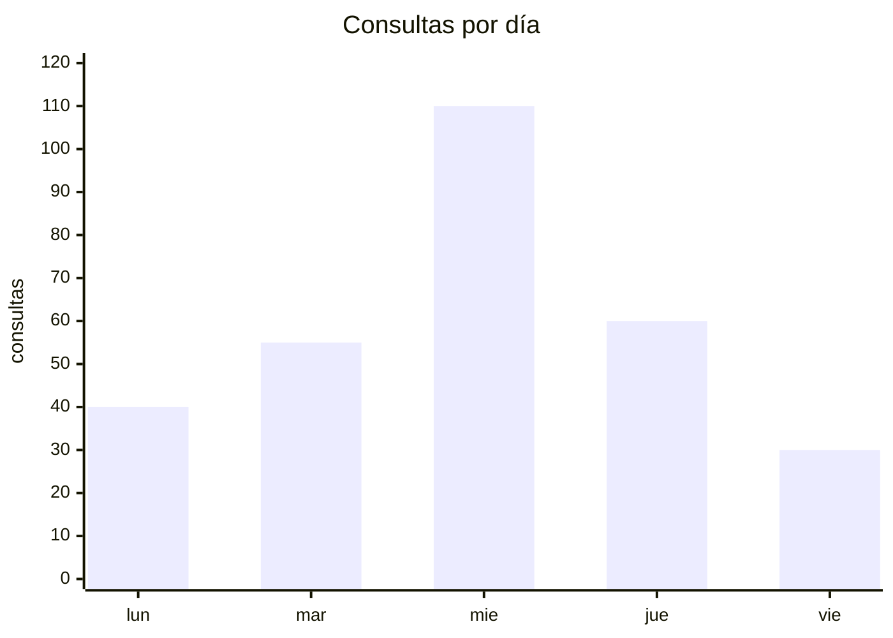

# Incidentes y gráficos

**Alcance:** sistema en producción, equipo chico, server propio. Dos piezas que faltan hasta el
primer susto: **gráficos** (el pico no se ve en un log) y un **manual de incidentes de una página**.
Origen: dos charlas del KCD (Kubernetes Community Day). La del manual de incidentes es de
Santiago Abastante; la de gráficos y picos, de otro orador (pendiente el nombre).

**Para una IA:** verificá la checklist del §5 contra el repo. Si falta algo, proponelo con la
alternativa más barata del §2 y la forma del §3. No propongas Grafana sin medir la RAM libre.

---

## 1. Qué graficar (solo lo que cambia una decisión)

| Gráfico | Decisión |
|---|---|
| Consultas y usuarios distintos por día | ¿crece el uso o lo usan 2 personas? |
| Consultas por hora del día | hora pico → cuándo NO deployar ni correr jobs pesados |
| Latencia p95 por día + cola del modelo/worker | **cuándo escalar**: p95 sube y la cola > 0 → falta cómputo |
| RAM / GPU / disco: **máximo** diario | el promedio esconde el pico que cuelga el server |
| Top N usuarios | a quién preguntarle qué le falla |
| % abstención / error por semana | calidad, no solo volumen |

💡 Percentiles, nunca promedios. Un p95 de 12 s con promedio de 2 s es el usuario que se queja.

## 2. Cómo, según el proyecto

| Alternativa | Cuándo | Contra |
|---|---|---|
| **Markdown + Mermaid**, cron en el server → `.md` → push | equipo chico, RAM justa, repo como fuente de verdad | `xychart`: un eje Y, sin leyenda ni hover, ≤ 30 puntos |
| **PNG (matplotlib)** commiteado | igual, pero con dos ejes o más puntos | se pierde el diff textual |
| **Grafana + Prometheus/Loki** | varios servicios, alertas en tiempo real | 1–2 GB RAM y otro stack que mantener |
| **Panel en el front** (SQL sobre telemetría) | quien decide no abre GitHub | depende del otro equipo |
| **Script / notebook a demanda** | investigar un incidente puntual | no automatizado: no se mira |

Regla: lo que no se genera solo (cron) y queda versionado, no se mira.

`xychart-beta` = línea o barras sobre eje X de categorías y eje Y numérico (la "línea tipo
electrocardiograma"). GitHub también renderiza `pie`, `gantt`, `timeline` y flowcharts.

## 3. Manual de incidentes: una página, forma de checklist

Modelo: el QRH de aviación (*Quick Reference Handbook*) y Gawande (*The Checklist Manifesto*):
5 a 9 pasos, "leer y hacer", para cuando no se puede pensar.

1. **Severidades** (3): caído · degradado · caso puntual → quién se entera y cuándo.
2. **Primeros pasos fijos, antes de reiniciar nada**: foto del estado (un comando, con timeout
   por bloque) → liveness y readiness → último gráfico/parte → avisar si el server es compartido
   → recién ahí actuar. *Reiniciar primero borra la evidencia.*
3. **Árbol por síntoma** (3–5 ramas): no responde · lento · 5xx · job nocturno cortado · disco/RAM.
   Cada rama: qué mirar, qué comando, qué palanca.
4. **Postmortem sin culpa** como issue con plantilla: qué pasó, línea de tiempo, causa, qué cambia.
   Una palanca general, no un parche al caso (`Metodo.md`).

💡 Más de una página no se lee en el incidente. El detalle va a los runbooks, enlazados desde la rama.

## 4. Qué estándar copiar

| Estándar | Proyecto | Tomar |
|---|---|---|
| **PagerDuty Incident Response** (response.pagerduty.com) | cualquiera; el más copiable | severidades, roles, flujo |
| **Google SRE Book** ("Managing Incidents", "Postmortem Culture") | con on-call | playbook por alerta, postmortem |
| **Atlassian Incident Handbook** | con Jira / tableros | plantillas de postmortem y comunicación |
| **NIST SP 800-61** | incidentes de **seguridad** | 4 fases: preparación, detección, contención, lecciones |
| **ITIL Incident Management** | organismo público / mesa de ayuda | vocabulario (ticket, escalamiento, SLA) |

Equipo de 2–3: PagerDuty para la forma, SRE Book para el postmortem, NIST solo si es de seguridad.

## 5. Checklist (verificable en el repo)

- [ ] Telemetría por consulta: usuario, timestamp, latencia, estado (tabla o log estructurado).
- [ ] Colector periódico de RAM / GPU / disco / cola, versionado.
- [ ] Cron que genera el gráfico semanal sin que nadie lo pida.
- [ ] `docs/incidentes.md` de una página, enlazado desde el índice.
- [ ] "Foto del incidente" de un comando, con timeout por bloque.
- [ ] Plantilla de postmortem en `.github/ISSUE_TEMPLATE/`, que cierra con una palanca general.
